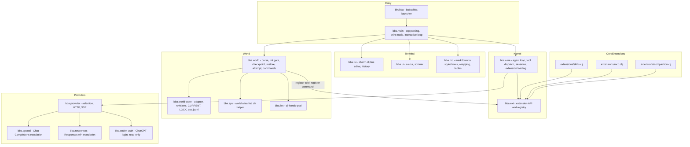
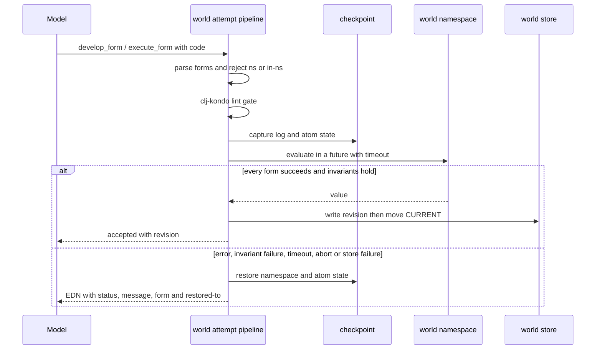
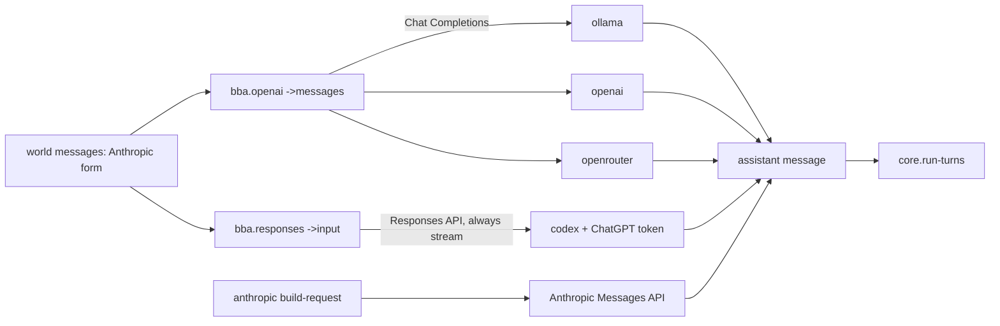
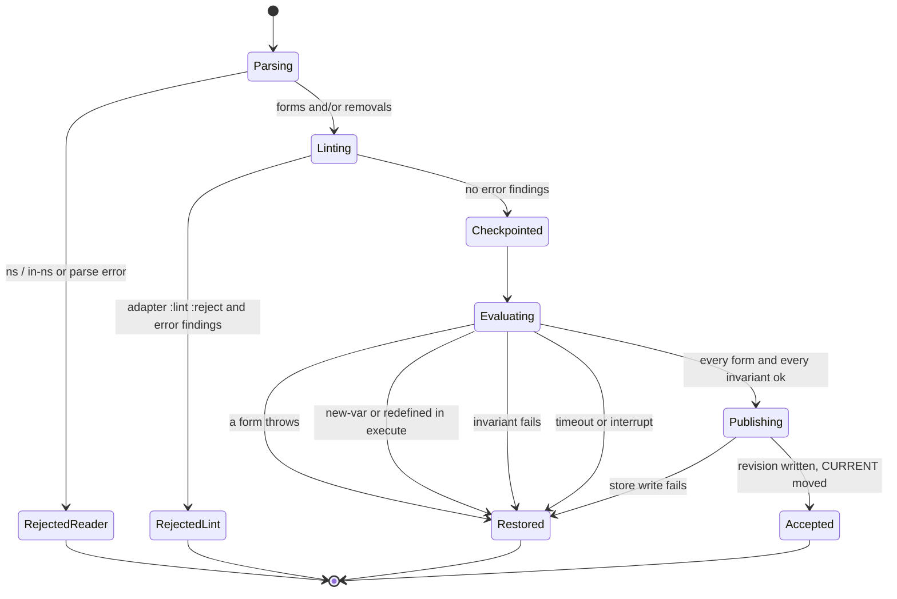
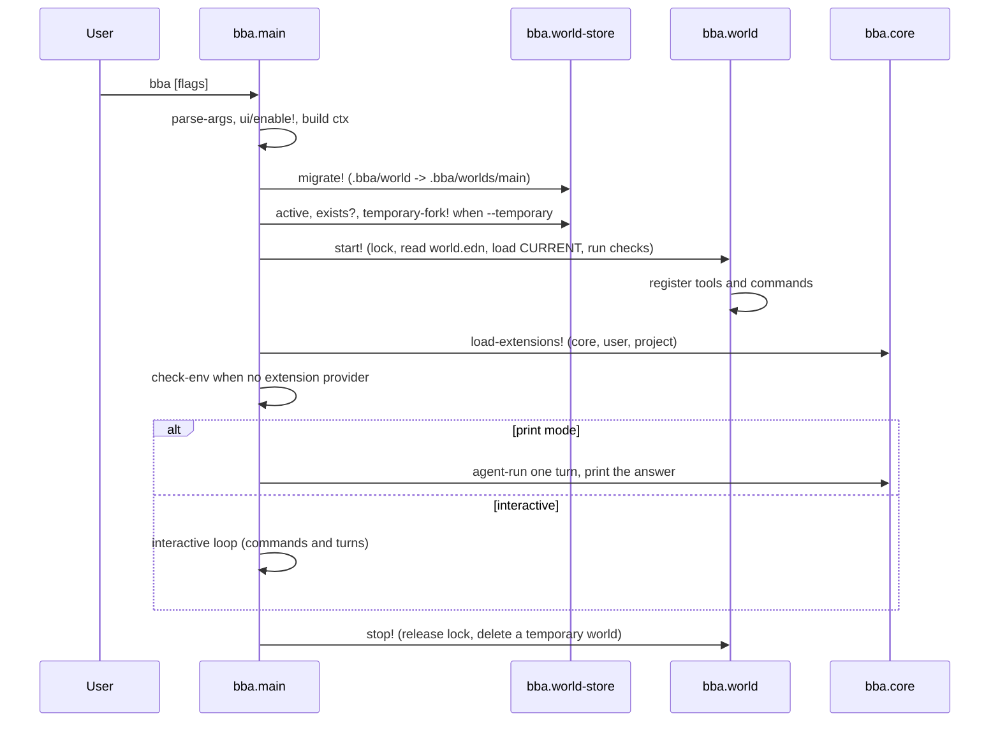
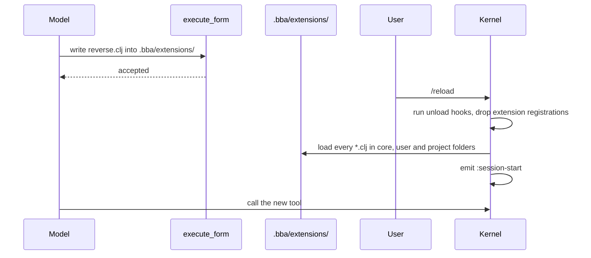
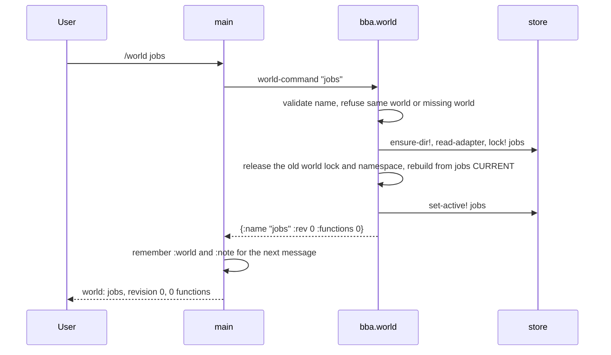
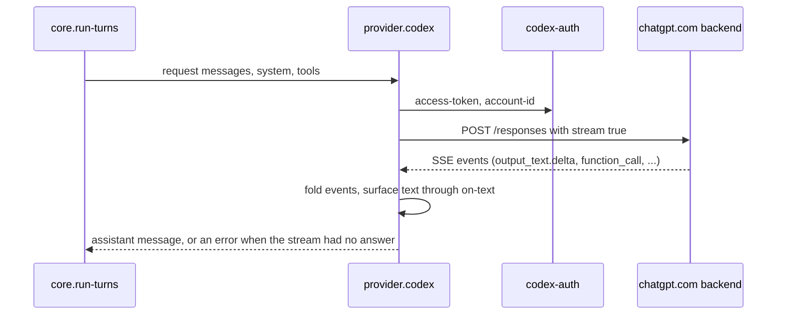

# bba — Software Requirements Specification (EARS)

| Field | Value |
|---|---|
| **System name in this document** | `bba` |
| **Artifact** | reverse-engineered specification of the `bba` repository |
| **Revision analysed** | `ccc6c1d` (Sync bba from bb-claude: core extensions, codex provider, temp worlds), branch `main` |
| **Method** | static reading of `src/`, `extensions/`, `bin/`, `test/`, `examples/`, `bb.edn`, `README.md` |
| **Notation** | EARS: ubiquitous, event-driven (When), state-driven (While), unwanted behaviour (If/Then), optional feature (Where), complex (Where -> While -> When/If) |
| **Status** | every requirement is **implemented** unless listed in section 7 |

## 1. Purpose and scope

bba is a terminal coding agent written in Clojure on babashka. Instead of editing files through patch
tools, bba opens one live Clojure namespace -- the *world* -- in the folder where it is started, and grows
it by conversation: the model adds or changes definitions with `develop_form`, runs code with
`execute_form`, and every accepted change is persisted as an immutable revision. There is no build step.

This document specifies externally observable behaviour: command-line surface, world evaluation semantics,
persistence and restore guarantees, provider abstraction, extension API, session handling, and the three
core extensions. Internal data shapes are recorded where they cross a module boundary, because those shapes
are the system's real interface (extension authors and world code depend on them).

Out of scope: line-by-line commentary on private helpers performance tuning, and any guarantee of isolation --
bba has **no sandbox** (see R-NFR-7).

## 2. System overview

### 2.1 Design lineage

- **Jiti** (ghuntley.com/lisp) -- "the product builds the product": two tools, one live namespace,
  checkpoints, revisions.
- **pi** (pi.dev) -- a minimal agent kernel with everything else as an extension.

bba is explicitly *not* Common Lisp: there are no conditions and no restarts. A failed attempt is restored
and reported; the model then writes a new attempt.

### 2.2 Architecture



### 2.3 Module map

| Module | Approx. lines | Responsibility |
|---|---|---|
| `src/bba/core.clj` | 222 | System prompt, agent loop (`run-turns`), tool dispatch (`run-tool`), request hooks, sessions, extension loading. Kernel, with `ext.clj` kept under 500 lines total. |
| `src/bba/ext.clj` | 103 | Extension registry: `register-tool!`, `register-command!`, `on!`, `on-unload!`, `set-provider!`, lookup fns, `emit`, `reset-extensions!`. Every registration is tagged with its source file. |
| `src/bba/world.clj` | 570 | The evaluator: form parsing, lint gate, checkpoint/restore, `attempt!`, `rollback!`, catalogue, world system prompt, the `/develop` `/execute` `/preview` `/rollback` `/functions` `/describe` `/history` `/status` commands, world switching. |
| `src/bba/world_store.clj` | 235 | Pure file I/O for `.bba/worlds/<name>/`: adapter template and validation, atomic writes, revisions, `CURRENT`, advisory `LOCK`, `ops.jsonl`, migration and forking. |
| `src/bba/sys.clj` | 28 | `world-requires` (aliases every world gets) and `sh` (bash helper with timeout and process-tree kill). |
| `src/bba/lint.clj` | 57 | clj-kondo through the babashka pod; synthesises the `ns` header from `world-requires`. |
| `src/bba/provider.clj` | 192 | Provider registry, `check-env`, `build-request`, `post-json`, `post-stream` (SSE), Anthropic stream folding, `from-env`. |
| `src/bba/openai.clj` | 91 | Chat Completions translation, used by `openai`, `openrouter` and `ollama`. |
| `src/bba/responses.clj` | 169 | Responses API translation, used by `codex`. |
| `src/bba/codex_auth.clj` | 66 | Read-only access to the Codex CLI login (`~/.codex/auth.json`) and JWT claim reading. |
| `src/bba/main.clj` | 299 | `parse-args`, one-turn driver `agent-run`, streaming printer, SIGINT cancellation, built-in commands, `interactive`, `run`, `-main`. |
| `src/bba/tui.clj` | 183 | Charm.clj-backed line editor: pure `press->key` and `handle-key`, pure `view-str` frame, history file. |
| `src/bba/md.clj` | 453 | Markdown to terminal rows: pure `md-line`/`render`, inline spans, wrapping, fenced panels, tables, `stream-row`. Widths in display cells via charm. |
| `src/bba/ui.clj` | 71 | ANSI colours and the spinner worker. Every helper is identity when colour is off, so a caller styles unconditionally. |
| `extensions/skills.clj` | 506 | Agent Skills: discovery, validation, the `activate_skill` tool, `/skills`. |
| `extensions/mcp.clj` | 351 | MCP servers as tools, JSON-RPC demultiplexing, both protocol eras, `/mcp`. |
| `extensions/compaction.clj` | 458 | Context-window compaction as a `:request` hook, `/compact`. |

Dependency direction: `main -> core -> ext`, `main -> world -> {world-store, lint, sys, ext}`,
`core -> provider -> {openai, responses, codex-auth}`. `world-store`, `openai` and `responses` are pure
translation layers: their only effects are file writes and HTTP calls performed by their callers.
`main -> {tui, md, ui}` and `md -> ui`: the terminal layer renders; nothing below it prints.

## 3. Requirements (EARS)

The system name in every requirement below is **bba**, verbatim. Each requirement has exactly one `shall`
and one verifiable response. Keywords mark the pattern: `When` (event-driven), `While` (state-driven),
`If ... then` (unwanted behaviour), `Where` (optional feature), and combinations in the order
`Where` -> `While` -> `When`/`If` (complex).

### 3.1 Invocation and command line (`R-CLI`)

| ID | Requirement | Source |
|---|---|---|
| R-CLI-1 | bba shall be started by the executable `bin/bba`, which adds the repository's `src` folder to the babashka classpath and calls `bba.main/-main` with the command-line arguments. | `bin/bba` |
| R-CLI-2 | bba shall accept the arguments `-p PROMPT`, `--print PROMPT`, `-c`, `--continue`, `--world NAME`, `--provider NAME`, `--model NAME`, `--max-turns N`, `--no-extensions`, `--temporary`, `--temp`, `-h` and `--help`. | `main/parse-args` |
| R-CLI-3 | When `-p PROMPT` or `--print PROMPT` is given, bba shall print only the final answer and exit with status 0 when the turn status is `:ok` and 1 otherwise. | `main/run`, `main/run-session` |
| R-CLI-4 | If an argument is not recognised, then bba shall print `unknown argument: <arg>` followed by the usage line and exit with status 1. | `main/parse-args`, `main/run` |
| R-CLI-5 | If `-p`, `--max-turns`, `--provider` or `--model` is given without a value, then bba shall report `<flag> needs a value` (or `needs a number`) with the usage line and exit with status 1. | `main/parse-args` |
| R-CLI-6 | When `--provider` or `--model` is given, bba shall write it into the environment map as `BBA_PROVIDER` or `BBA_MODEL` before the provider is selected. | `main/run` |
| R-CLI-7 | While standard input is not a terminal, bba shall read plain lines, print only whole answers, and disable the raw-mode line editor, the spinner and incremental streaming. | `main/line-reader`, `main/run` |
| R-CLI-8 | When `--temporary` or `--temp` is given, bba shall fork the world named by `--world`, else the session's world, else the last active world, into a `tmp-<id>` world marked disposable, and delete that world when the session ends. | `main/run`, `store/temporary-fork!`, `world/stop!` |
| R-CLI-9 | When `-c` is given, bba shall load the latest session file in the folder and open the world recorded in that session, unless `--world` names one. | `main/run`, `core/latest-session`, `core/session-world` |
| R-CLI-10 | If `--world NAME` names a world that does not exist while the folder already has worlds, then bba shall exit with status 1 and a message listing the worlds and the `/world new` hint. | `world/start!`, `main/run` |
| R-CLI-11 | When bba is given `--world` with no name, bba shall ignore the flag and warn `--world needs a name (the old flag is ignored)`. | `main/parse-args` |
| R-CLI-12 | When `--max-turns N` is not given, bba shall use `BBA_MAX_TURNS`, else 200. | `main/run`, `core/default-max-turns` |

### 3.2 Worlds and the world store (`R-WORLD`, `R-STORE`)

| ID | Requirement | Source |
|---|---|---|
| R-WORLD-1 | bba shall keep each world in `<cwd>/.bba/worlds/<name>/`, holding `world.edn`, `revisions/`, `CURRENT`, `LOCK` and `ops.jsonl`. | `store/world-dir`, `store/ensure-dir!` |
| R-WORLD-2 | bba shall name the first world `main`. | `store/default-world` |
| R-WORLD-3 | bba shall accept a world name of 1 to 64 characters of lowercase letters and digits joined by single hyphens, and reject the names `new`, `fork`, the empty string, `../x`, `a/b` and 65-character names. | `store/valid-name?` |
| R-WORLD-4 | If `world.edn` does not declare `:ns` as a simple symbol outside the harness namespaces clojure, bba, babashka, sci, cheshire, rewrite-clj and user, then bba shall refuse to open the world. | `store/read-adapter` |
| R-WORLD-5 | When a key is missing from `world.edn`, bba shall supply the default `:ns world`, `:invariants []`, `:goals []`, `:timeout-ms 3600000`, `:max-result-chars 4000`, `:lint :reject`. | `store/default-adapter` |
| R-WORLD-6 | When a world folder is created, bba shall write `world.edn` from the documented template and a `.gitignore` listing `revisions/`, `CURRENT`, `LOCK`, `ops.jsonl` and `*.tmp`, and not list `world.edn`. | `store/ensure-dir!`, `store/adapter-template` |
| R-WORLD-7 | When the store still has the single-world layout `.bba/world/`, bba shall move that folder to `.bba/worlds/main/` and warn. | `store/migrate!` |
| R-WORLD-8 | If `.bba/world/` is held by a live process, then bba shall refuse the migration and report the pid. | `store/migrate!` |
| R-WORLD-9 | While a world is open, bba shall hold its advisory `LOCK` and release it when switching away from the world and at shutdown. | `store/lock!`, `world/open!`, `world/stop!` |
| R-WORLD-10 | If the lock names a pid that is alive, then bba shall refuse to open the world with `world in use by pid <pid>`. | `store/lock!` |
| R-WORLD-11 | If the lock names a pid that is not alive, then bba shall warn `taking over stale world lock from pid <pid>` and take over the lock. | `store/lock!` |
| R-WORLD-12 | bba shall record the world in use in `.bba/worlds/ACTIVE` and open that world at start when it still exists and `--world` is not given. | `store/active`, `store/set-active!`, `world/start!` |
| R-WORLD-13 | When `/world` is given with no argument, bba shall list the worlds, marking the open one with `*`, with its revision and, for a fork, its origin. | `world/world-command`, `world/list-worlds` |
| R-WORLD-14 | When `/world new NAME` is given, bba shall create an empty world of that name and not switch to it. | `world/create!` |
| R-WORLD-15 | When `/world fork NAME [REV]` is given, bba shall create world `NAME` whose revision 1 holds the log, state and adapter of revision `REV` of the open world, with type `:fork` and `:forked-from {:world <source> :rev REV}`. | `world/create!`, `store/fork!` |
| R-WORLD-15a | When `/world fork NAME` is given without `REV`, bba shall fork the current revision of the open world. | `world/create!`, `store/fork!` |
| R-WORLD-15b | When `/world fork NAME 0` is given, bba shall create an empty world. | `world/create!`, `store/fork!` |
| R-WORLD-16 | If the named revision does not exist, then bba shall report `unknown revision: <n>` and leave no world folder behind. | `store/fork!` |
| R-WORLD-17 | When `/world temp` is given, bba shall fork the open world into a temporary world, switch to it, and print that it is destroyed when the session ends. | `world/world-command` |
| R-WORLD-18 | If a world switch fails, then bba shall keep the current world open, keep its lock, and report the reason (`world in use by pid ...`, `... is not allowed`, `no world <name>` or `already in world <name>`). | `world/switch!`, `store/lock!`, `store/read-adapter` |
| R-WORLD-19 | bba shall load every world namespace with the aliases `str`, `set`, `fs`, `sys`, `http`, `json`, `csv`, `yaml`, `io`, `edn`, `walk`, `pp` and `proc`, and re-require them on every rebuild so they survive restores. | `sys/world-requires`, `world/replay!` |
| R-WORLD-20 | bba shall reject any world form headed `ns` or `in-ns` with class `reader` and the message that every form runs in the world namespace. | `world/parse-forms` |
| R-WORLD-21 | bba shall present the catalogue as the accepted def forms with the last definition winning, removals applied, and each entry carrying the live arglists, docstring, source and defining revision. | `world/catalogue` |
| R-WORLD-22 | bba shall warn at start-up for each adapter invariant that fails, and report the invariant and goal tally in `/status`. | `world/open!`, `world/status` |

| ID | Requirement | Source |
|---|---|---|
| R-STORE-1 | bba shall publish each accepted attempt as a new revision file `revisions/%06d.edn` and never rewrite or delete an existing revision file. | `store/publish!` |
| R-STORE-2 | bba shall write every store file atomically, by writing a hidden temp file in the same directory and moving it into place. | `store/atomic-spit!` |
| R-STORE-3 | bba shall write the complete revision file before moving `CURRENT`, so a crash cannot make a half-written revision current. | `store/publish!` |
| R-STORE-4 | When bba starts and revisions above `CURRENT` exist, bba shall warn `ignored interrupted operation r<n>` and never reuse the orphan revision numbers. | `world/load-from-disk!`, `store/next-rev` |
| R-STORE-5 | If `CURRENT` is missing or corrupt, then bba shall warn and use the highest revision on disk. | `world/load-from-disk!` |
| R-STORE-6 | If the revision named by `CURRENT` does not load, then bba shall try lower revisions, warn `world revision r<n> does not load` and `world running from r<m>`, and run from the highest revision that loads without changing `CURRENT`. | `world/load-from-disk!` |
| R-STORE-7 | When bba opens a world, bba shall delete leftover `.*.tmp` files in the world folder and in `revisions/` and report each one. | `store/delete-tmp!`, `world/open!` |
| R-STORE-8 | When `/rollback N` is given, bba shall publish the log and state of revision `N` as a new revision of type `:rollback` with `:rollback-of N`, keeping every revision in history. | `world/rollback!` |
| R-STORE-9 | If `/rollback` names a revision that does not exist, then bba shall report `unknown revision: <n>` and write no revision. | `world/rollback!` |
| R-STORE-10 | If the rollback target breaks an adapter invariant, then bba shall restore the state it had before the rollback and reject with `:reason :invariant`. | `world/rollback!` |
| R-STORE-11 | bba shall append one JSON line per attempt to the world's `ops.jsonl` with `:op-id`, `:op`, `:outcome`, `:ms`, `:revision` and `:ts`, and echo the line on stderr when `BBA_DEBUG` is set. | `store/log-op!`, `world/finish` |
| R-STORE-12 | bba shall record in each revision the ordered `:log`, the printable `:state`, the names of unprintable state vars, `:rev`, `:base-rev`, `:type`, `:input`, `:remove`, `:op-id` and `:ts`. | `world/publish-snapshot!`, `store/publish!` |
| R-STORE-13 | bba shall persist only public state vars whose value reads back as equal data, and warn listing the vars it could not save. | `world/printable?`, `world/publish-snapshot!` |

### 3.3 Evaluation, checkpoints and restore (`R-EVAL`)

| ID | Requirement | Source |
|---|---|---|
| R-EVAL-1 | bba shall expose exactly two tools to the model: `develop_form {code, remove?}`, which adds, redefines or removes definitions, and `execute_form {code}`, which evaluates an expression. | `world/register!` |
| R-EVAL-2 | When `develop_form` is called, bba shall append the form's exact source to the accepted log, and record the defined name and kind for `defn`, `defmacro`, `def`, `defonce` and `defmulti` forms. | `world/parse-forms`, `world/attempt-checked!` |
| R-EVAL-3 | When `develop_form` is called with a `remove` list, bba shall unmap each named var from the world namespace and append a removal entry to the accepted log. | `world/run-body`, `world/attempt-checked!` |
| R-EVAL-4 | If `develop_form` names a var that is not public in the world namespace, then bba shall fail with class `remove` and the message `unknown name(s): <names>` and not unmap anything. | `world/run-body` |
| R-EVAL-5 | When `execute_form` is called, bba shall evaluate the forms in the live world namespace, return the printed value of the last form, and not append to the accepted log. | `world/run-body`, `world/attempt-checked!` |
| R-EVAL-6 | If `execute_form` defines a new var, then bba shall reject with reason `:new-var` and the list of names, and restore the checkpoint. | `world/run-body` |
| R-EVAL-7 | If `execute_form` redefines or removes an existing var, then bba shall reject with reason `:redefined` and the list of names, and restore the checkpoint. | `world/run-body` |
| R-EVAL-8 | When forms are accepted, bba shall return an EDN map with `:status :accepted`, `:value` (the printed last value), `:op`, `:ms` and `:revision`. | `world/run-body`, `world/finish` |
| R-EVAL-9 | When an accepted attempt defines or removes names, bba shall add `:defined` or `:removed` to the result. | `world/attempt-checked!` |
| R-EVAL-10 | If evaluating a form throws, then bba shall restore the checkpoint, report status `:error` with `:class`, `:message`, `:form`, `:form-index` and `:data` (the exception data, bounded to 1000 characters), and write no revision. | `world/run-body`, `world/error-result` |
| R-EVAL-11 | If a multi-form develop attempt throws on a later form, then bba shall roll back the earlier forms too, so the attempt is all-or-nothing. | `world/attempt-checked!` |
| R-EVAL-12 | If the code cannot be parsed, then bba shall report status `:error` with class `reader` and the parse message, and write no revision. | `world/parse-forms` |
| R-EVAL-13 | If the code contains no form and no removal, then bba shall report `nothing to evaluate` with class `reader`. | `world/attempt-checked!` |
| R-EVAL-14 | If a removal list is given to the execute operation, then bba shall fail with `only develop can remove names`. | `world/attempt-checked!` |
| R-EVAL-15 | If an accepted attempt fails an adapter invariant, then bba shall restore the checkpoint and reject with reason `:invariant`, the failed check names under `:failed`, and `:restored-to <rev>`. | `world/run-body`, `world/attempt-checked!` |
| R-EVAL-16 | When the preview operation runs, bba shall return status `:preview` with the value, discard all effects including definitions and atom contents, and write no revision. | `world/attempt!`, `world/run-body` |
| R-EVAL-17 | bba shall evaluate goals on every accepted change, report them as `{:name :ok}` entries under `:checks :goals`, and never reject a change for a failed goal. | `world/run-body` |
| R-EVAL-18 | When a restore runs, bba shall remove the world namespace, recreate it, re-require the alias list, and replay the accepted log in order, unmapping removed names. | `world/replay!` |
| R-EVAL-19 | When a restore runs, bba shall reset every public var holding an atom or a volatile to the value recorded in the checkpoint. | `world/restore!`, `world/live-state` |
| R-EVAL-20 | bba shall bound every result value with `pr-str` under `*print-length* 100` and `*print-level* 10`, cut at the adapter's `:max-result-chars` with the note `...[truncated: <n> chars]`. | `world/bounded` |
| R-EVAL-21 | While an attempt runs, bba shall apply the adapter's `:timeout-ms`. | `world/attempt-checked!` |
| R-EVAL-21a | If the attempt timeout expires, then bba shall cancel the evaluating future, count a timed-out thread, restore the checkpoint, and report class `timeout` with the runaway-thread note. | `world/attempt-checked!` |
| R-EVAL-22 | When the attempt thread is interrupted (Ctrl-C), bba shall cancel the future, restore the checkpoint, log outcome `aborted`, and rethrow. | `world/attempt-checked!`, `world/with-sigint` |
| R-EVAL-23 | If publishing the revision fails after the evaluation succeeded, then bba shall restore the checkpoint and report class `store` with `:restored-to <rev>`. | `world/attempt-checked!` |
| R-EVAL-24 | bba shall record `:restore-ms` for the last restore and add `:restored-to <rev>` to every failed non-preview result. | `world/restore!`, `world/attempt-checked!` |
| R-EVAL-25 | When a checkpoint is taken, bba shall capture the ordered log, the live atom and volatile contents, and the root value of every public var. | `world/checkpoint` |
| R-EVAL-26 | bba shall expose `(sys/sh "command")`, which runs bash in the working folder and returns stdout and stderr merged. | `sys/sh` |
| R-EVAL-26a | When a command run through `sys/sh` exits with a status other than zero, bba shall append `[exit N]` to the returned string. | `sys/sh` |
| R-EVAL-26b | If a command run through `sys/sh` exceeds its timeout (default 120 s) or the attempt is interrupted, then bba shall kill the whole process tree. | `sys/sh` |



### 3.4 Lint gate (`R-LINT`)

| ID | Requirement | Source |
|---|---|---|
| R-LINT-1 | bba shall lint each attempt with clj-kondo before evaluation, using the world namespace and the alias list as the namespace header and the live definitions plus non-definition log forms as context. | `lint/lint`, `lint/header`, `world/lint-context` |
| R-LINT-2 | While the adapter has `:lint :reject` (the default), when clj-kondo reports an error, bba shall reject the attempt with reason `:lint`, the list of error findings and the message `clj-kondo found errors; nothing was evaluated`, and evaluate nothing. | `world/attempt!` |
| R-LINT-3 | When clj-kondo reports only warnings, bba shall evaluate the code and attach the findings as `:lint` on the result. | `world/attempt!` |
| R-LINT-4 | Where the adapter has `:lint :warn`, bba shall evaluate the code even when clj-kondo reports errors, with the findings attached to the result. | `world/lint-forms`, `world/attempt!` |
| R-LINT-4a | Where the adapter has `:lint :off`, bba shall skip clj-kondo entirely. | `world/lint-forms`, `world/attempt!` |
| R-LINT-5 | bba shall report findings as maps with `:row`, `:col`, `:level`, `:type` and `:message`, with rows counted within the submitted code. | `lint/lint` |
| R-LINT-6 | bba shall check arity against the world's own functions, so a call with the wrong number of arguments is rejected as `:invalid-arity`. | `world/lint-context` |
| R-LINT-7 | If the clj-kondo babashka pod cannot be loaded, then bba shall warn once (`clj-kondo pod unavailable, world forms are not linted`) and evaluate every attempt unlinted. | `lint/run-fn` |
| R-LINT-8 | bba shall disable the `:namespace-name-mismatch`, `:unused-namespace` and `:redefined-var` linters, because forms are snippets in a live namespace. | `lint/config` |

### 3.5 Agent loop and tools (`R-LOOP`)

| ID | Requirement | Source |
|---|---|---|
| R-LOOP-1 | bba shall build each provider request from the message list, the system prompt and the tool specs sorted by tool name. | `core/run-turns`, `core/tool-specs` |
| R-LOOP-2 | When the provider reply contains no `tool_use` block, bba shall finish the turn with status `:ok` and the concatenated text blocks as the answer. | `core/run-turns` |
| R-LOOP-3 | While the provider reply contains `tool_use` blocks, bba shall run each tool, show a line before and after each call, and feed the results back as a `tool_result` user message. | `core/run-turns` |
| R-LOOP-4 | When the turn reaches the maximum number of provider calls, bba shall stop with status `:max-turns` and the text `stopped: reached max turns (<n>)`. | `core/run-turns` |
| R-LOOP-5 | bba shall always return a `tool_result` block from a tool call and never throw out of the dispatcher. | `core/run-tool` |
| R-LOOP-5a | When a tool call is interrupted, bba shall propagate the interrupt so the turn can stop. | `core/run-tool` |
| R-LOOP-6 | If the tool name is unknown, then bba shall return `unknown tool: <name>` marked as an error. | `core/run-tool` |
| R-LOOP-7 | If a required input key is missing, then bba shall return `missing input: <keys>` marked as an error. | `core/run-tool` |
| R-LOOP-8 | If the tool handler throws, then bba shall return `tool error: <message>` marked as an error. | `core/run-tool` |
| R-LOOP-9 | bba shall append every assistant message, including each `tool_use`, to the session file before the tool runs. | `core/run-turns`, `core/log-message!` |
| R-LOOP-10 | When bba continues a session, bba shall keep only complete exchanges, from user text through the final answer, and drop a cancelled or crashed turn so that a dangling `tool_use` never reaches the provider. | `core/replayable` |
| R-LOOP-11 | bba shall place the world prompt, the extension API summary, and `AGENTS.md` from `BBA_HOME` and from the working folder into the model's instructions. | `world/system-prompt`, `core/prompt-for`, `core/agents-md` |
| R-LOOP-12 | While a world is open, bba shall include in the model's instructions the world name, the namespace, the working folder, the tool list, the alias list, the invariant and goal status, and up to 60 catalogue entries with arglists and the first docstring line. | `world/system-prompt` |
| R-LOOP-13 | When the world changes, bba shall prefix the next user message with a note naming the new world, its revision and its functions. | `world/switch-note`, `main/interactive` |
| R-LOOP-14 | When a `:tool-call` hook returns a block map, bba shall not run the tool, return `blocked: <reason>` marked as an error, and let the first blocking hook win. | `core/blocked-reason` |
| R-LOOP-15 | If a `:tool-call` hook throws, then bba shall block the call with the hook's error as the reason. | `core/blocked-reason` |
| R-LOOP-16 | bba shall let each `:request` hook replace the outgoing request, once per turn, evaluated against the live context. | `core/apply-request-hooks` |
| R-LOOP-17 | If a `:request` hook throws or returns a value that is not a request map with a `:messages` vector, then bba shall ignore it, warn, and keep the previous request. | `core/apply-request-hooks` |
| R-LOOP-18 | bba shall print streamed model text as it arrives, and redraw a finished line with its rendered markdown when that line occupies one screen row. | `main/stream-printer`, `md/stream-row` |
| R-LOOP-18a | When a streamed line occupies more than one screen row, bba shall leave it as printed, so a redraw cannot scroll the rows above it. | `main/stream-printer` |
| R-LOOP-18b | bba shall carry the renderer state across streamed lines, so an open fenced block reaches the rows that follow it. | `main/stream-printer` |
| R-LOOP-19 | When Ctrl-C arrives while the model works, bba shall cancel the turn, print `(cancelled)`, keep the conversation as it was before the user message, and restore any running world attempt. | `main/with-cancel` |

### 3.6 Sessions (`R-SESS`)

| ID | Requirement | Source |
|---|---|---|
| R-SESS-1 | bba shall record each session as a JSONL file at `<cwd>/.bba/sessions/<yyyyMMdd-HHmmss>-<id>.jsonl`, and create a `.gitignore` containing `*` in that folder. | `core/new-session-file` |
| R-SESS-2 | bba shall write one JSON object per message with `:role`, `:content`, `:ts` and the world name. | `core/log-message!` |
| R-SESS-3 | If a session file already exists, then bba shall treat it as immutable history and append only. | `core/new-session-file`, `main/interactive` |
| R-SESS-3a | When `/new` is given, bba shall start a new session file and leave the old one in place. | `core/new-session-file`, `main/interactive` |
| R-SESS-4 | When `-c` is given, bba shall sort the session files by name and continue the last one. | `core/latest-session` |
| R-SESS-5 | bba shall read the world of a session from the last line that carries one, and fall back to the last active world when that world is gone, with a warning. | `core/session-world`, `main/run` |
| R-SESS-6 | While compaction is active, bba shall leave the on-disk session file unchanged. | `core/tool-specs`, `extensions/compaction.clj` |

### 3.7 Providers (`R-PROV`)

| ID | Requirement | Source |
|---|---|---|
| R-PROV-1 | bba shall select the provider from `BBA_PROVIDER`, lower-cased, defaulting to `ollama`. | `provider/provider-name` |
| R-PROV-2 | bba shall provide the providers `ollama` (default model `deepseek-v4.1-flash:cloud`, base `http://localhost:11434`, override `OLLAMA_HOST`), `anthropic` (key `ANTHROPIC_API_KEY`, model `claude-opus-5-5`), `openai` (key `OPENAI_API_KEY`, model `gpt-5`, base `https://api.openai.com/v1`, override `OPENAI_BASE_URL`), `openrouter` (key `OPENROUTER_API_KEY`, model `anthropic/claude-opus-5.5`, override `OPENROUTER_BASE_URL`) and `codex` (no key, model `gpt-5.6-luna`, base `https://chatgpt.com/backend-api/codex`, override `CODEX_BASE_URL`). | `provider/providers` |
| R-PROV-3 | If `BBA_MODEL` is set, then bba shall use it in place of the provider's default model. | `provider/model`, `provider/model-name` |
| R-PROV-4 | If the selected provider is unknown, then bba shall report `unknown provider: <n>` and the list of known providers. | `provider/check-env` |
| R-PROV-5 | While a provider requires an API key and that key is blank, bba shall report `<KEY> is not set`. | `provider/check-env` |
| R-PROV-6 | If no extension provides a provider and the provider check fails while print mode was requested, then bba shall write the problem to stderr and exit with status 1. | `main/run-session` |
| R-PROV-6a | If no extension provides a provider and the provider check fails in interactive mode, then bba shall warn `<problem>; manual /commands only` and continue with the world commands available. | `main/run-session` |
| R-PROV-7 | When `POST` to a provider fails with a transport error, bba shall raise `cannot connect to <uri>`. | `provider/post-json`, `provider/post-stream` |
| R-PROV-8 | If a provider answers with a status outside 200-299, then bba shall raise `API error <status>: <message>` using the provider's error message when the body parses. | `provider/api-error` |
| R-PROV-9 | When `BBA_DEBUG_REQUEST` names a file, bba shall write the JSON request body there before sending, best-effort, and never fail because of it. | `provider/maybe-dump-request!` |
| R-PROV-10 | When a stream is requested, bba shall fold the server-sent-event data lines into the reply, stopping at the `[DONE]` sentinel. | `provider/post-stream`, `provider/sse-data` |
| R-PROV-11 | bba shall translate the world's message form to and from the Chat Completions API in `bba.openai` and to and from the Responses API in `bba.responses`, so that only the world's own message shape reaches the kernel. | `openai/->messages`, `responses/->input` |
| R-PROV-12 | While the `codex` provider is selected, bba shall always stream, because the endpoint rejects `stream` false. | `responses/build-request` |
| R-PROV-13 | If the `codex` provider streams neither text nor a tool call, then bba shall raise an error naming the reason (`max_output_tokens` with the retry hint, or `the server streamed an empty response`), instead of returning an empty assistant message. | `responses/->reply` |
| R-PROV-14 | If a `codex` stream stops early but did produce text or a tool call, then bba shall keep the partial answer. | `responses/->reply` |
| R-PROV-15 | bba shall read the `codex` credentials without ever writing or refreshing them, taking `CODEX_ACCESS_TOKEN` when set, else `tokens.access_token` from `$CODEX_HOME/auth.json` or `~/.codex/auth.json`. | `codex-auth/access-token` |
| R-PROV-16 | If no readable ChatGPT token is found, then bba shall report that a `codex login` is needed and where bba looks. | `provider/check-env` |
| R-PROV-16a | If the ChatGPT token has expired, then bba shall report that a `codex login` renews it. | `provider/check-env` |
| R-PROV-17 | bba shall derive the account id and plan from the token's claims without failing on an unreadable JWT. | `codex-auth/account-id`, `codex-auth/plan`, `codex-auth/expired?` |
| R-PROV-18 | When `/provider NAME [MODEL]` is given, bba shall keep the conversation and apply the new provider from the next request. | `main/switch-provider`, `main/switch-model` |
| R-PROV-18a | When `/model NAME` is given, bba shall set only the model for the next requests. | `main/switch-provider`, `main/switch-model` |
| R-PROV-19 | If an extension provides a provider, then bba shall use it in place of the environment-derived provider and say so when the model is displayed. | `core/run-turns`, `main/show-model` |



### 3.8 Extension API (`R-EXT`)

| ID | Requirement | Source |
|---|---|---|
| R-EXT-1 | bba shall load extension files from the core folder `extensions/`, then `$BBA_HOME/extensions/`, then `<cwd>/.bba/extensions/`, in that order, sorted by file name. | `core/load-extensions!`, `core/extension-dirs` |
| R-EXT-2 | Where `--no-extensions` is given, bba shall load only the core extensions. | `core/load-extensions!` |
| R-EXT-3 | bba shall tag every registration with the file that made it, so `/reload` can remove exactly the extension entries and keep the built-ins. | `ext/*source*`, `ext/put!` |
| R-EXT-4 | bba shall expose `register-tool!` for a map with a string `:name` and a function `:handler`, and throw when either is missing. | `ext/register-tool!` |
| R-EXT-5 | bba shall expose `register-command!`, `on!` (events `:session-start`, `:tool-call`, `:request`), `on-unload!` and `set-provider!`. | `ext/register-command!`, `ext/on!`, `ext/on-unload!`, `ext/set-provider!` |
| R-EXT-6 | bba shall pass tool handler input keys as keywords and a context map with `:cwd` and `:env`. | `core/run-tool`, `ext/register-tool!` |
| R-EXT-7 | If an extension file fails to load, then bba shall warn with the file name and continue loading the remaining files. | `core/load-extension!` |
| R-EXT-8 | When `/reload` runs, bba shall run the unload hooks of the extensions being dropped, newest first, remove their registrations, reload every extension file, and emit `:session-start`. | `ext/reset-extensions!`, `main/builtin-commands` |
| R-EXT-9 | If an unload hook throws, then bba shall warn and ignore it. | `ext/run-unloaders!` |
| R-EXT-10 | If an extension replaces a registration from a different source, then bba shall warn which source replaces what. | `ext/put!` |
| R-EXT-11 | When `:session-start` is emitted, bba shall emit it at session start, on `/new`, and after `/reload`. | `main/run-session`, `main/interactive`, `main/builtin-commands` |

### 3.9 Terminal interface (`R-TUI`, `R-MD`)

| ID | Requirement | Source |
|---|---|---|
| R-TUI-1 | While stdin and stdout are a terminal and `TERM` is not `dumb`, bba shall read entries with the charm.clj line editor and its history. | `tui/tty?`, `main/line-reader` |
| R-TUI-1a | If stdin or stdout is not a terminal, or `TERM` is `dumb`, then bba shall read plain lines. | `tui/tty?`, `main/line-reader` |
| R-TUI-2 | bba shall keep the input history in `$BBA_HOME/history`, one JSON string per line, reading at most the last 500 entries. | `tui/load-history`, `tui/add-history` |
| R-TUI-3 | bba shall implement, as pure key handling, insert, newline, enter, backspace, delete, left, right, home, end, kill-to-start, kill-to-end, kill-word, up, down, Ctrl-C and Ctrl-D. | `tui/handle-key` |
| R-TUI-3a | bba shall translate charm.clj key-press messages into that key vocabulary in a pure function, ignoring messages it does not bind. | `tui/press->key` |
| R-TUI-4 | When Enter is pressed with a trailing backslash, or Alt+Enter is pressed, bba shall insert a newline instead of submitting. | `tui/handle-key` |
| R-TUI-5 | bba shall render one frame per charm message as a pure function of the edit state, showing the prompt, the buffer and a reverse-video caret at the cursor. | `tui/view-str` |
| R-TUI-5a | bba shall indent the continuation of a wrapped or new line by the width of the plain prompt, so styling escapes cannot shift the layout. | `tui/view-str` |
| R-TUI-5b | bba shall deliver bracketed pastes as one insert, with carriage returns normalised to newlines. | `tui/entry-update` |
| R-TUI-6 | When Ctrl-D is pressed on an empty buffer, or `/quit` or `/exit` is typed, bba shall exit the session. | `tui/handle-key`, `main/interactive` |
| R-TUI-6a | When Ctrl-C is pressed on an empty buffer, bba shall clear the line and stay in the session. | `tui/handle-key`, `main/interactive` |
| R-TUI-7 | bba shall disable colours and the spinner when output is not a terminal or when `NO_COLOR` is set. | `ui/enable!` |
| R-TUI-8 | While the model works, bba shall show a spinner labelled `thinking...` or `running <tool>...` with elapsed seconds, and pause it to print progress lines. | `ui/start!`, `ui/log!`, `main/agent-run` |
| R-TUI-9 | bba shall render model text as markdown on a terminal: headings, bullets, quotes, rules, fenced panels, tables and inline spans become styled rows. | `md/md-line`, `md/render` |

#### 3.9.1 Markdown renderer (`R-MD`)

The renderer is pure. `md-line` maps `[ctx line]` to `[ctx' rows]`, so it can be driven one
line at a time while text streams; `render` walks a whole document, because table detection
needs one line of lookahead.

| ID | Requirement | Source |
|---|---|---|
| R-MD-1 | bba shall measure every width in display cells through charm, so an escape sequence or a double-width character cannot shift a row, a panel or a column. | `md/width-of` |
| R-MD-2 | bba shall keep the renderer pure: `md-line` and `render` take a context and text and return data rather than printing. | `md/md-line`, `md/render` |
| R-MD-3 | bba shall carry renderer state in the context and thread it from one `md-line` call to the next, so a fenced block stays open across lines. | `md/context`, `md/md-line` |
| R-MD-4 | bba shall map each syntax element to a palette function of the styled text, replaceable as a whole from the context. | `md/default-palette`, `md/context` |
| R-MD-5 | bba shall keep the markup a palette function adds free of display cells, so a styled row measures as a plain one. | `md/default-palette`, `bba.ui` |
| R-MD-6 | Where rendering is off, bba shall return every line untouched, so a pipe receives the markdown as it came. | `md/context`, `md/render` |
| R-MD-7 | bba shall wrap a paragraph to the context width, breaking between words and dropping the space the row was broken at. | `md/wrap-rows`, `md/text-block` |
| R-MD-8 | When a single word is longer than a row, bba shall cut it at the last display cell that fits, so a long path cannot rely on the terminal's own wrapping. | `md/wrap-rows`, `md/fit` |
| R-MD-9 | bba shall never split a grapheme when it fits or cuts text. | `md/fit` |
| R-MD-10 | bba shall choose the inline rule that matches earliest, so a code span wins over the emphasis inside it. | `md/spans`, `md/inline-rules` |
| R-MD-10a | bba shall recognise code, bold, italic, strikethrough, link and image as inline spans. | `md/inline-rules` |
| R-MD-11 | bba shall require a boundary around an emphasis marker, so a mid-word asterisk stays literal. | `md/inline-rules` |
| R-MD-12 | bba shall render a link as its label and add the target only when the two differ. | `md/spans`, `md/piece` |
| R-MD-13 | Where colour is enabled, bba shall emit a link as an OSC 8 hyperlink. | `md/osc8`, `ui/enabled?` |
| R-MD-13a | Where colour is off, bba shall emit a link as its bare label. | `md/osc8` |
| R-MD-14 | bba shall render each heading level as bold, and the first level as bold and underlined, keeping the hash marks as its marker. | `md/md-line`, `md/default-palette` |
| R-MD-15 | bba shall mark a bullet with a single glyph and an ordered item with its own number. | `md/md-line` |
| R-MD-15a | bba shall indent a wrapped list continuation past the marker. | `md/hanging` |
| R-MD-16 | bba shall prefix a quote with a bar and align its continuation under the text. | `md/md-line` |
| R-MD-17 | bba shall render a thematic break as a rule across the full width. | `md/md-line` |
| R-MD-18 | While a fence is open, bba shall take each line literally, so a backtick or an asterisk there is a character and not markup. | `md/md-line`, `md/code-row` |
| R-MD-19 | bba shall render a fenced block as a panel with a labelled opening rule and a closing rule. | `md/fence-open`, `md/fence-close` |
| R-MD-19a | bba shall mark every body row of a fenced block with a vertical bar. | `md/code-row`, `md/panel` |
| R-MD-20 | bba shall pad every panel row to the context width, so the panel stays closed however the code wraps. | `md/panel` |
| R-MD-21 | bba shall omit the delimiter row from the rendered table. | `md/render` |
| R-MD-21a | bba shall draw a table row as its own bars and cells, with no padding outside the first and last bar. | `md/table` |
| R-MD-22 | bba shall align each table column as the delimiter row indicates and size it to its widest visible cell. | `md/align-of`, `md/table` |
| R-MD-23 | bba shall cap a table to the context width, shrinking the widest column until the row fits. | `md/table` |
| R-MD-24 | bba shall render markdown inside a table cell. | `md/cell` |
| R-MD-24a | When a table cell is wider than its column, bba shall take it from its plain text, so no escape is left unbalanced. | `md/cell` |
| R-MD-25 | When a streamed line is unfinished, bba shall return only the rows that are already complete and a flag saying whether anything was held back. | `md/stream-row` |
| R-MD-26 | While a fence is open, bba shall keep a blank line as a panel row. | `md/md-line` |

### 3.10 Commands (`R-CMD`)
### 3.10 Commands (`R-CMD`)

| ID | Requirement | Source |
|---|---|---|
| R-CMD-1 | bba shall recognise a line starting with `/` as a command and run a built-in first, else a registered extension command, else print `unknown command: /<name> (try /help)`. | `main/run-command` |
| R-CMD-2 | bba shall provide `/develop CODE`, `/execute CODE`, `/preview CODE` and `/rollback N`, which run the world directly with no model in the loop. | `world/register!` |
| R-CMD-3 | When `/develop` is given one or more `-NAME` arguments, bba shall treat them as removals and submit an empty code string. | `world/develop-args` |
| R-CMD-4 | bba shall provide `/functions`, `/describe NAME`, `/history` and `/status`, and print `no functions yet` for an empty catalogue and `unknown function: <name> (try /functions)` for an unknown name. | `world/register!`, `world/describe` |
| R-CMD-5 | bba shall provide `/world`, `/reload`, `/provider`, `/model`, `/help`, `/clear`, `/new`, `/quit` and `/exit` as built-ins. | `main/builtin-commands`, `main/interactive` |
| R-CMD-6 | When `/history` runs, bba shall list every revision with its op id, type, timestamp and a clipped input, marking the current revision with `*`. | `world/history` |
| R-CMD-7 | When `/status` runs, bba shall print the world, namespace, revision and base revision, the function count, the invariant and goal tallies, the last restore time, and the timed-out thread count when it is positive. | `world/status` |
| R-CMD-8 | When `/describe NAME` runs, bba shall print the name, kind, defining revision, arglists, docstring and source. | `world/describe` |
| R-CMD-9 | If an extension command throws, then bba shall warn `/ <name> failed: <message>` and keep the session. | `main/run-command` |
| R-CMD-10 | When `/help` runs, bba shall list the built-in commands and every registered extension command. | `main/help-text` |

### 3.11 Core extensions (`R-CEXT`)

| ID | Requirement | Source |
|---|---|---|
| R-CEXT-1 | bba shall always load the core extensions `skills.clj`, `mcp.clj` and `compaction.clj`, also with `--no-extensions`. | `core/load-extensions!` |

#### Skills (Agent Skills specification)

| ID | Requirement | Source |
|---|---|---|
| R-CEXT-2 | bba shall treat a directory containing `SKILL.md` as a skill and read `name` and `description` as required frontmatter, with `license`, `compatibility`, `metadata` and `allowed-tools` optional. | `skills/validate-dir`, `skills/known-fields` |
| R-CEXT-3 | bba shall scan `~/.agents/skills`, `~/.claude/skills`, `~/.bba/skills` and the `BBA_SKILLS_EXTRA` roots always, and `<cwd>/.agents/skills` and `<cwd>/.bba/skills` only while trusted. | `skills/scope-dirs` |
| R-CEXT-4 | While `BBA_SKILLS_TRUST` is `1` or the skills root holds a `.trusted` file, bba shall treat a project's skill folders as trusted. | `skills/trusted?` |
| R-CEXT-5 | bba shall keep a skill name to 1-64 characters of lowercase letters and digits joined by single hyphens, matching its directory name. | `skills/valid-name?` |
| R-CEXT-6 | bba shall register one `activate_skill` tool whose description carries the tier-1 catalogue of skill names and descriptions and whose handler returns the full `SKILL.md` body plus a listing of the skill's bundled files. | `skills/reregister-tool!`, `skills/catalog-prompt` |
| R-CEXT-7 | When a project skill and a user skill share a name, bba shall use the project skill and report the collision. | `skills/discover`, `skills/show-summary` |
| R-CEXT-8 | If a skill deviates from the specification, then bba shall warn and still load it. | `skills/validate-file`, `skills/show-validation` |
| R-CEXT-8a | When `/skills validate PATH` is given, bba shall check the skill strictly and report each error. | `skills/validate-file`, `skills/show-validation` |
| R-CEXT-9 | bba shall support `/skills`, `/skills show NAME`, `/skills validate PATH` and `/skills reload`, and rescan on every `:session-start`. | `skills/register-command!`, `skills/on!` |

#### MCP

| ID | Requirement | Source |
|---|---|---|
| R-CEXT-10 | bba shall read MCP server configuration from `$BBA_HOME/mcp.json` always and from `<cwd>/.bba/mcp.json` only while trusted, accepting a JSON object with or without an `mcpServers` key. | `mcp/server-configs`, `mcp/trusted?` |
| R-CEXT-11 | While `BBA_MCP_TRUST` is `1` or the project holds `.bba/mcp.trusted`, bba shall treat the project's MCP configuration as trusted. | `mcp/trusted?` |
| R-CEXT-12 | bba shall expose each MCP tool as `mcp__<server>__<tool>` with the server's input schema passed through as the tool input schema. | `mcp/tool-name`, `mcp/register-all!` |
| R-CEXT-13 | bba shall speak both protocol eras: modern (`server/discover` with per-request metadata, 2026-07-28 and later) and legacy (the `initialize` handshake, 2025-11-25 and earlier), over stdio only. | `mcp/handshake!`, `mcp/modern-meta` |
| R-CEXT-14 | bba shall match replies by JSON-RPC id and drop notifications without an id rather than mistaking them for answers. | `mcp/read-loop!` |
| R-CEXT-15 | bba shall start MCP servers with the session, stop a server after ten idle minutes, restart it on the next call, and stop every server on `/reload`. | `mcp/idle-ms`, `mcp/stop-all!`, `mcp/on-unload!` |
| R-CEXT-16 | If an MCP server fails to start or a call times out, then bba shall warn and report the error without stopping the session. | `mcp/register-all!`, `mcp/rpc` |
| R-CEXT-17 | bba shall support `/mcp` (list servers and status) and `/mcp stop` (stop every server). | `mcp/register-command!` |

#### Compaction

| ID | Requirement | Source |
|---|---|---|
| R-CEXT-18 | bba shall register a `:request` hook that sends the provider a smaller derived view: the task statement, a summary of the middle, and the last turns verbatim. | `compaction/handle-request`, `compaction/plan` |
| R-CEXT-19 | bba shall never modify the session file when it compacts, so a bad summary is always recoverable. | `compaction/compacted` |
| R-CEXT-20 | bba shall read compaction settings from `$BBA_HOME/compaction.edn` and `<cwd>/.bba/compaction.edn`, with the project file winning, defaulting to `:enabled? true`, `:mode :continuous`, `:auto? true`, `:threshold-tokens 60000`, `:keep-turns 6`, `:fold-min-tokens 3000`, `:max-summary-tokens 2000`, `:cache? true` and a summariser of `{:provider nil :model nil :max-tokens 2048 :timeout-s 60}`. | `compaction/config`, `compaction/defaults` |
| R-CEXT-21 | Where the mode is `:continuous`, bba shall fold older turns into one rolling summary, so every message is summarised once. | `compaction/continuous-view`, `compaction/plan` |
| R-CEXT-21a | Where the mode is `:threshold`, bba shall re-summarise the whole middle each time the window fills. | `compaction/continuous-view`, `compaction/plan` |
| R-CEXT-22 | bba shall never split a tool call from its tool result when it chooses the protected tail. | `compaction/pair-safe-tail` |
| R-CEXT-23 | If summarisation fails, then bba shall send the whole conversation. | `compaction/compact-request` |
| R-CEXT-24 | bba shall support `/compact`, `/compact on`, `/compact off` and `/compact model PROVIDER [MODEL]`. | `compaction/register-command!` |

### 3.12 Persistence and effects outside the world (`R-EFF`)

| ID | Requirement | Source |
|---|---|---|
| R-EFF-1 | bba shall leave file and process effects of a failed attempt in place, and state this in the model's instructions. | `world/system-prompt` |
| R-EFF-2 | bba shall replay accepted `develop_form` source in the order recorded on every restore, so a top-level effect in a develop form runs again on each restore. | `world/replay!` |
| R-EFF-3 | bba shall keep the working folder as the default directory for `(sys/sh)`, and offer a per-call `:dir` option instead of changing directory. | `sys/sh` |
| R-EFF-4 | bba shall keep `.bba/` out of version control through the repository `.gitignore` and the `.gitignore` it writes into the world and session folders. | `.gitignore`, `store/ensure-dir!`, `core/new-session-file` |

### 3.13 Non-functional requirements (`R-NFR`)

| ID | Requirement | Source |
|---|---|---|
| R-NFR-1 | bba shall keep the agent kernel (`core.clj` plus `ext.clj`) below 500 lines. | `test/bba_test.clj` `ac7-core-size` |
| R-NFR-2 | When `bin/bba --help` is run, bba shall print the usage line and exit with status 0. | `test/bba_test.clj` `nfr4-startup-time` |
| R-NFR-2a | bba shall reach the usage line within 5 seconds of a `--help` invocation. | `test/bba_test.clj` `nfr4-startup-time` |
| R-NFR-3 | bba shall run its whole test suite offline, with a fake provider and no network access. | `bb.edn` `test` task |
| R-NFR-4 | bba shall keep the provider translation layers (`openai.clj`, `responses.clj`) pure functions of their input, so they are testable without a server. | `openai.clj`, `responses.clj` |
| R-NFR-5 | bba shall bound every result handed to the model by `:max-result-chars`, so a large value cannot exhaust the context window. | `world/bounded` |
| R-NFR-6 | bba shall hold at most one world lock per folder per live process and name the conflicting pid. | `store/lock!` |
| R-NFR-7 | bba shall run world code with the user's rights, with no sandbox. | `README.md` Safety |
| R-NFR-7a | bba shall document, in the README safety section, that the world is not sandboxed. | `README.md` Safety |
| R-NFR-8 | bba shall keep session and world data local except for the conversation and world data sent to the selected provider. | `README.md` Safety |

## 4. Data models

### 4.1 World adapter (`world.edn`)

```clojure
;; Read with clojure.edn (no reader eval). Missing keys get the defaults below.
{:ns world                  ; simple symbol; a fresh name, never a harness or library namespace
 :invariants [{:name "reverse works" :form (= "cba" (reverse-string "abc"))}]
 :goals      [{:name "has shout" :form (ifn? shout)}]
 :timeout-ms 3600000        ; README documents 30000 as the practical default
 :max-result-chars 4000
 :lint :reject}             ; :reject | :warn | :off

;; A temporary world's adapter adds:
;; :temporary? true :source-world "main" :source-revision 3
```

### 4.2 Revision file (`revisions/%06d.edn`)

```clojure
{:rev 4
 :op-id "<uuid>"
 :ts "2026-10-08T12:00:00Z"
 :type :develop             ; :develop | :execute | :preview | :rollback | :fork
 :base-rev 3                ; the revision the attempt started from
 :input "(defn f [x] x)"
 :remove ["old-name"]
 :log [{:source "(defn f [x] x)" :defines f :kind :fn :rev 4}
       {:remove old-name :rev 4}]
 :state {counter 0}         ; public vars holding atoms/volatiles, as data
 :unprintable ["socket"]   ; names whose live value could not be written
 :rollback-of nil
 :forked-from {:world "main" :rev 1}}   ; fork revisions only
```

### 4.3 Attempt result (what the model and the tool get back)

```clojure
; accepted
{:status :accepted :value "\"cba\"" :op "develop" :ms 12 :revision 7
 :defined ["reverse-string"] :removed []
 :checks {:invariants [{:name "reverse works" :ok true}]
          :goals      [{:name "has shout" :ok false :error "Unable to resolve symbol: shout"}]}
 :lint [{:row 1 :col 12 :level :warning :type :unused-binding :message "..."}]}

; preview writes nothing
{:status :preview :value "1" :op "preview" :ms 3}

; failure shapes
{:status :rejected :reason :invariant :failed [{:name "reverse works"}] :restored-to 6}
{:status :rejected :reason :lint :lint [{:row 2 :type :unresolved-symbol}] :message "clj-kondo found errors; nothing was evaluated"}
{:status :rejected :reason :new-var :vars [sneaky] :message "execute_form must not define vars; use develop_form"}
{:status :rejected :reason :redefined :vars [reverse-string]}
{:status :error :class "java.lang.ArithmeticException" :message "Divide by zero" :form "(/ 1 0)" :form-index 0}
{:status :error :class "reader" :message "Unexpected EOF"}
{:status :error :class "timeout" :message "evaluation exceeded 30000 ms; a runaway thread may still use CPU until bba exits"}
{:status :error :class "aborted" :message "interrupted"}
{:status :error :class "store" :message "..." :restored-to 6}
{:status :error :class "remove" :message "unknown name(s): nope"}
```

### 4.4 Extension registrations

```clojure
{:tools     {"develop_form" {:name :description :input-schema :handler :source}}
 :commands  {"skills" {:name :handler :source}}
 :hooks     {:tool-call [{:handler f :source p}] :request [...] :session-start [...]}
 :provider  {:fn f :source :builtin}
 :unloaders [{:handler f :source p}]}
```

### 4.5 Messages between the kernel and a provider

Messages always use the world's own shape (the shape the Anthropic API uses); translation to other APIs 
happens in `bba.openai` and `bba.responses`.

```clojure
{:role "user"      :content [{:type "text" :text "..."}]}
{:role "assistant" :content [{:type "text" :text "..."}
                              {:type "tool_use" :id "t1" :name "execute_form" :input {:code "..."}}]}
{:role "user"      :content [{:type "tool_result" :tool_use_id "t1" :content "{...}"}]}

;; provider request: {:messages [...] :system "..." :tools [...] :on-text f}
;; provider reply:   {:role "assistant" :content [...] :stop_reason "tool_use" | "end_turn"}
```

### 4.6 Session line (`<cwd>/.bba/sessions/*.jsonl`)

```clojure
{:role "assistant" :content [...] :ts 1780000000000 :world "main"}
```

### 4.7 Ops line (`<cwd>/.bba/worlds/<name>/ops.jsonl`)

```clojure
{"op-id":"<uuid>","op":"execute","outcome":"accepted","ms":12,"revision":7,"ts":"..."}
;; outcome is one of accepted, preview, rejected-<reason>, error, timeout, aborted
```

### 4.8 State machine: the life of one attempt



## 5. Interfaces

### 5.1 Model-facing tools

| Tool | Input schema | Returns |
|---|---|---|
| `develop_form` | `{code: string (required), remove?: string[]}` | EDN of the attempt result; `is_error` unless status is `:accepted` or `:preview`. |
| `execute_form` | `{code: string (required)}` | EDN of the attempt result; `is_error` unless status is `:accepted` or `:preview`. |
| `activate_skill` | `{name: string (required)}` | The skill's `SKILL.md` body plus its bundled-file listing; `is_error` when the skill is unknown. (core extension) |
| `mcp__<server>__<tool>` | The MCP server's own input schema | The MCP server's result content. (core extension, only when `mcp.json` names servers) |

### 5.2 Command-line interface

| Flag | Effect |
|---|---|
| `-p PROMPT`, `--print PROMPT` | Print mode: one turn, print only the answer, exit 0 on status `:ok`. |
| `-c`, `--continue` | Continue the latest session in this folder, in the world that session used. |
| `--world NAME` | Open world `NAME`. A bare `--world` warns and is ignored. |
| `--provider NAME`, `--model NAME` | Override `BBA_PROVIDER` / `BBA_MODEL`. |
| `--max-turns N` | Cap provider calls per turn (default 200, or `BBA_MAX_TURNS`). |
| `--no-extensions` | Load core extensions only. |
| `--temporary`, `--temp` | Work in a throwaway world, deleted at exit. |
| `-h`, `--help` | Print usage, exit 0. |

| Environment variable | Effect |
|---|---|
| `BBA_PROVIDER`, `BBA_MODEL` | Provider and model. |
| `BBA_HOME` | Folder for history, user extensions and user config (default `~/.bba`). |
| `BBA_MAX_TURNS` | Same as `--max-turns`. |
| `BBA_SKILLS_TRUST=1`, `BBA_SKILLS_EXTRA` | Trust project skill folders; add skill roots (path-separator separated). |
| `BBA_MCP_TRUST=1` | Trust the project's `.bba/mcp.json`. |
| `ANTHROPIC_API_KEY`, `OPENAI_API_KEY`, `OPENROUTER_API_KEY`, `OPENAI_BASE_URL`, `OPENROUTER_BASE_URL`, `OLLAMA_HOST` | Provider credentials and endpoints. |
| `CODEX_HOME`, `CODEX_ACCESS_TOKEN`, `CODEX_BASE_URL` | The `codex` provider's login and endpoint. |
| `NO_COLOR` | Plain output. |
| `BBA_DEBUG=1` | Stack traces and ops echoes on stderr. |
| `BBA_DEBUG_REQUEST` | Write each provider request body to this file. |

### 5.3 Slash commands

| Command | Kind | Effect |
|---|---|---|
| `/develop CODE`, `/develop -NAME ...` | world | Add, change or remove definitions. |
| `/execute CODE` | world | Run code and keep the result. |
| `/preview CODE` | world | Run code, show the result, keep nothing. |
| `/rollback N` | world | Republish revision `N` as a new revision. |
| `/world [NAME | new NAME | fork NAME [REV] | temp]` | world | List, switch, create, fork, or open a temporary fork. |
| `/functions`, `/describe NAME` | world | List functions, or show one. |
| `/history`, `/status` | world | Show revisions, or world and check state. |
| `/reload`, `/provider`, `/model`, `/help`, `/clear` | main | Extensions, provider, model, help, clear screen. |
| `/new`, `/quit`, `/exit` | main | New session, exit. |
| `/skills [reload | show NAME | validate PATH]` | core extension | List, inspect, validate or rescan skills. |
| `/mcp [stop]` | core extension | List MCP servers, or stop them all. |
| `/compact [status | on | off | model PROVIDER [MODEL]]` | core extension | Show or change compaction. |

### 5.4 Extension API

```clojure
(ns my-ext (:require [bba.ext :as ext]))

;; A tool for the model. The handler gets input keys as keywords and a ctx map.
(ext/register-tool! {:name "shout" :description "Upper-case text."
                     :input-schema {:type "object" :properties {:text {:type "string"}} :required ["text"]}
                     :handler (fn [{:keys [text]} ctx] (str/upper-case text))})
                     ; return a string or {:content s :is-error true}

(ext/register-command! "hi" (fn [args ctx] (println "hi" args)))  ; the user types /hi

(ext/on! :tool-call     (fn [{:keys [name input]} ctx] nil))  ; {:block true :reason ".."} blocks
(ext/on! :request       (fn [{:keys [request]} ctx] nil))     ; {:request req'} transforms the request
(ext/on! :session-start (fn [_ ctx] nil))                     ; start, /new, after /reload
(ext/on-unload! (fn [] nil))                                  ; cleanup when /reload drops the extension
(ext/set-provider! (fn [{:keys [messages system tools]}]) )   ; replace the provider
```

| API | Signature | Contract |
|---|---|---|
| `ext/register-tool!` | `[tool]` | Needs a string `:name` and a fn `:handler`; throws otherwise. `:description` defaults to `""`, `:input-schema` to `{:type "object" :properties {}}`. |
| `ext/register-command!` | `[name handler]` | The handler is `(fn [args-string ctx])`. |
| `ext/on!` | `[event handler]` | Events `:session-start`, `:tool-call`, `:request`. Hooks append; they are not replaced. |
| `ext/on-unload!` | `[f]` | Zero-argument cleanup, run newest first, errors warned and ignored. |
| `ext/set-provider!` | `[f]` | `(fn [{:keys [messages system tools on-text]}])` returns an assistant message. |
| `ext/emit` | `[event payload ctx]` | Runs non-guard hooks; a hook error warns and is ignored (fail-open). |
| `ctx` | map | `:cwd` (working folder), `:env` (environment map), plus `:home`, `:session-file`, `:world`, `:max-turns`, `:tty?`, `:stream?`. |

### 5.5 World namespace surface

Every world namespace receives these aliases and no `:require` of its own (R-WORLD-20 forbids `ns` and `in-ns`):

| Alias | Library |
|---|---|
| `str` | `clojure.string` |
| `set` | `clojure.set` |
| `fs` | `babashka.fs` |
| `sys` | `bba.sys` (`sh` helper) |
| `http` | `babashka.http-client` |
| `json` | `cheshire.core` |
| `csv` | `clojure.data.csv` |
| `yaml` | `clj-yaml.core` |
| `io` | `clojure.java.io` |
| `edn` | `clojure.edn` |
| `walk` | `clojure.walk` |
| `pp` | `clojure.pprint` |
| `proc` | `babashka.process` |

## 6. Critical workflows

### 6.1 Start-up



### 6.2 Extending bba at runtime (self-improvement)



### 6.3 World switch



### 6.4 Codex turn (Responses API)



## 7. Discrepancies and open questions

These are points where the code, the README and the tests disagree, or where behaviour is deliberately
left unpinned. They are recorded rather than turned into requirements.

| # | Observation | Evidence |
|---|---|---|
| D-1 | **Timeout default conflicts.** `store/default-adapter` and `adapter-template` use `:timeout-ms 3600000` (one hour); the README says the default is 30 s (`:timeout-ms 30000` in its example, and "The world stops an attempt after `:timeout-ms` (30 s by default)"); `world_test.clj` pins 200 ms for its own case. A fresh world therefore gets one hour, not 30 s. | `world_store.clj:12,20`; `README.md:129,320` |
| D-2 | **World file naming.** `README.md` and the world system prompt call the adapter `world.edn`, which matches the code. The task brief for this document referred to `world.json`; no JSON adapter exists. | `world_store.clj:70`; `README.md:123` |
| D-3 | **`:preview` has no public tool.** `world/attempt!` supports `:op :preview` and `/preview` is registered, but the preview op is not exposed as a fourth tool, so the model can only preview through a command. | `world.clj:159,401`; `world.clj:390-398` |
| D-4 | **`:execute` results are bounded, so `:value` is a string.** The model receives `pr-str` output, not data; round-tripping large values requires parsing. This is deliberate (R-NFR-5) but easy to mistake for a bug. | `world.clj:112-118` |
| D-5 | **Invariants fail closed, hooks fail open.** Invariant errors reject a change; a throwing `:tool-call` hook blocks the call; but throwing `:request` hooks, `:session-start` hooks and unloaders are warned and ignored. | `world.clj:125-129`; `core.clj:103-112,138-154`; `ext.clj:66-84` |
| D-6 | **Runaway threads cannot be stopped.** On timeout the future is cancelled, but a busy loop that never waits keeps a CPU until bba exits; `/status` counts them and the message says so. | `world.clj:224-230`, `world_test.clj:346-355` |
| D-7 | **`develop` side effects replay.** A top-level `println` in a develop form runs again on every restore. Pinned by a test, and the prompt tells the model to keep side effects in `execute_form`. | `world_test.clj:390-396`; `world.clj:315` |
| D-8 | **The world lock is advisory and pid-based.** It is a file holding a pid, checked with `ps`; `own-pid` shells out to `echo $PPID`. A stale lock is taken over with a warning, so the guarantee is mutual exclusion, not safety. | `world_store.clj:139-158` |
| D-9 | **`--world` with no name is silently ignored** (with a warning), for backwards compatibility with the pre-named-worlds flag. | `main.clj:33-36`, `world_test.clj:550` |
| D-10 | **The `codex` endpoint is undocumented and unversioned.** The README itself says to treat it as convenient, not contractual; model names differ from the metered API. | `README.md` Codex section |
| D-11 | **No sandbox.** World code runs with the user's rights, a `:tool-call` guard is a text check, and `--no-extensions` does not stop core extensions, the adapter's checks or the saved revisions. | `README.md` Safety |
| D-12 | **`world_test.clj`, `bba_test.clj`, `providers_test.clj`, `tui_test.clj` and `codex_test.clj` are the specification of record.** All requirements in section 3 are traceable to at least one of them; where a test is the only evidence, the requirement is marked with the test name rather than a source line. | `test/*.clj` |

## 8. Verification map

| Requirement group | Principal tests |
|---|---|
| `R-CLI-*`, `R-LOOP-*`, `R-SESS-*`, `R-EXT-*` | `bba_test.clj`: `ac1-print-mode-with-tool-use`, `ac2-extension-adds-tool`, `ac3-self-improvement-with-reload`, `ac4-hook-blocks-tool-call`, `ac5-broken-extension-does-not-stop-harness`, `ac6-missing-api-key`, `ac8-tool-errors-are-results`, `ac9-entry-point-name`, `max-turns-bound`, `agents-md-in-system-prompt`, `session-file-written-without-key`, `reload-drops-broken-file-registrations`, `unload-hooks-run-on-reload-and-drop-broken-files`, `hook-error-fails-closed-and-override-warns`, `request-hook-transforms-what-is-sent`, `request-hook-failure-is-fail-open`, `request-hook-bad-return-is-ignored`, `parse-args-cases`, `interactive-survives-provider-and-command-errors`, `session-start-event-and-no-extensions-flag`, `new-starts-a-fresh-session` |
| `R-WORLD-*`, `R-STORE-*`, `R-EVAL-*`, `R-LINT-*` | `world_test.clj`: `s1`-`s10`, `tools-through-the-agent-loop`, `goals-reported-not-enforced`, `execute-must-not-define-or-redefine`, `reader-errors-and-namespace-switches`, `multi-form-develop-is-all-or-nothing`, `lint-rejects-errors-before-evaluation`, `library-aliases-survive-restores`, `lint-warn-and-off`, `removal`, `timeout-restores`, `lock-held-by-live-process`, `startup-falls-back-when-latest-does-not-load`, `develop-side-effects-replay-on-restore`, `gitignore-and-default-adapter`, `adapter-ns-must-not-name-a-harness-namespace`, `restore-property-random-sequences`, `ctrl-c-interrupt-restores`, `old-single-world-moves-to-main`, `create-switch-and-isolate`, `fork-at-a-revision`, `failed-switch-keeps-the-current-world`, `world-names`, `cli-world-flag-and-continue` |
| `R-PROV-*` | `providers_test.clj`: `messages-to-chat-completions`, `tools-to-functions`, `reply-from-chat-completions`, `check-env-per-provider`, `parse-provider-and-model-flags`, `provider-flag-overrides-env-in-main`, `openai-over-http`, `openrouter-over-http`, `ollama-over-http`, `default-provider-is-ollama-deepseek`, `switch-commands-show-and-validate`, `switch-reaches-the-next-request`, `provider-command-takes-an-optional-model`; `codex_test.clj`: `auth-file-uses-codex-home`, `reading-jwt-claims`, `access-token-from-env-then-from-the-codex-file`, `check-env-for-codex`, `messages-to-responses-input`, `tools-are-flat-not-nested`, `build-request-always-streams`, `folding-a-stream`, `folding-edge-cases`, `codex-over-http`, `from-env-selects-codex`, `codex-runs-a-turn-end-to-end` |
| `R-MD-*` | `md_test.clj`: `inline-spans-name-their-element`, `a-code-span-wins-over-the-emphasis-inside-it`, `a-link-keeps-its-target`, `emphasis-needs-a-boundary`, `width-counts-cells-not-characters`, `fit-never-splits-a-wide-character`, `wrapping-fills-the-width`, `a-word-longer-than-the-row-is-cut`, `no-row-needs-the-terminals-own-wrap`, `a-row-is-not-widened-by-escape-styling`, `headings`, `bullets-get-a-marker`, `a-wrapped-bullet-stays-inside-its-marker`, `a-nested-bullet-keeps-its-indent`, `quotes-indent-under-a-bar`, `a-rule-spans-the-width`, `a-fenced-block-is-a-panel`, `markup-inside-a-fence-is-left-alone`, `a-fence-with-no-info-string-has-no-label`, `a-long-code-line-wraps-inside-the-panel`, `a-table-is-aligned-and-only-fits-the-width`, `a-header-without-a-delimiter-is-not-a-table`, `a-wide-table-is-capped-to-the-width`, `inline-markup-in-a-table-cell-is-rendered`, `a-line-that-fits-is-complete-and-one-row`, `a-wrapped-line-holds-back-its-partial-row`, `an-open-fence-is-not-complete`, `stream-row-is-pure`, `without-rendering-the-text-is-untouched`, `colour-off-still-removes-the-markup` |
| `R-NFR-1`, `R-NFR-2` | `bba_test.clj`: `ac7-core-size`, `nfr4-startup-time` |
| `R-CEXT-*` | No dedicated test file; exercised indirectly through `activate_skill` in `world_test.clj:246` and through the extension loader tests in `bba_test.clj`. This is the largest untested surface in the repository. |

## 9. Deployment and operation

```bash
git clone git@github.com:o3-cloud/bba.git
ln -s "$PWD/bba/bin/bba" ~/.local/bin/bba     # named bba so it never shadows bb
ollama serve                                  # the default provider needs no key
cd my-project && bba
```

| Task | Command |
|---|---|
| Run every test, offline, with a fake provider | `bb test` (`bb.edn` task; exits 1 on any failure) |
| Run bba from source | `bb agent -p "question"` (`bb.edn` task) |
| Print mode in a script | `cat question.txt \| bba -p "..."` (pipe input reads plain lines) |

| Path | Contents | In git? |
|---|---|---|
| `.bba/worlds/<name>/world.edn` | The world's settings, invariants and goals. | Yes, if you add it. |
| `.bba/worlds/<name>/revisions/`, `CURRENT`, `ops.jsonl`, `LOCK` | The saved world and the attempt log. | No; bba writes a `.gitignore`. |
| `.bba/worlds/tmp-<id>/` | A temporary world. | No; deleted at session end. |
| `.bba/worlds/ACTIVE` | The last world used. | Not ignored. |
| `.bba/sessions/` | One log file per session, plus the compaction cache. | No; bba writes a `.gitignore`. |
| `$BBA_HOME/history` | Input history (last 500 entries read). | — |
| `$BBA_HOME/extensions/`, `<cwd>/.bba/extensions/` | User and project extensions. | — |
| `$BBA_HOME/mcp.json`, `<cwd>/.bba/mcp.json` | MCP server configuration. | — |
| `$BBA_HOME/compaction.edn`, `<cwd>/.bba/compaction.edn` | Compaction settings. | — |

### Known limits (stated by the system itself)

- No restarts: a failure restores and reports; the model writes a new attempt.
- Effects outside the world stay done.
- Restores replay develop source, so side effects in a develop form repeat.
- The attempt timeout may not stop a thread that never waits.
- One bba for each folder, enforced by an advisory lock.
- No sandbox.